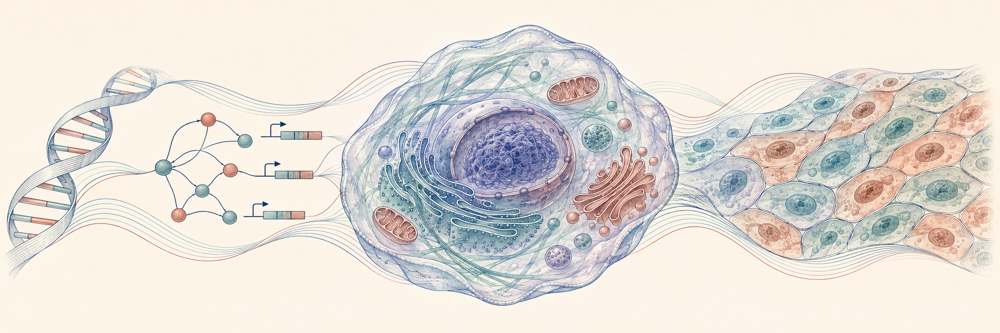
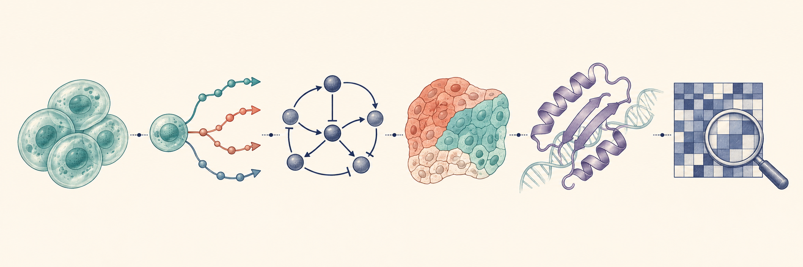

# Awesome Computational Biology Papers

**English** · [简体中文](README.zh-CN.md)

A curated reading list for single-cell and spatial omics, perturbation response, gene regulation, and machine learning for genomics and proteins. Each entry includes a short reading note and a public source.

**85 papers · 6 topics**\
Updated 2026-11-24. Preprints are labeled in the entries.

## Browse by topic

| Topic | Papers | Coverage |
| --- | ---: | --- |
| [Single-cell and multi-omics](#single-cell) | 17 | Foundation models, integration methods and cell atlases |
| [Perturbation modeling and virtual cells](#perturbation) | 17 | Response models, screening datasets and generalization benchmarks |
| [Gene regulation and function](#regulation) | 11 | Enhancer–gene links, regulons and network inference |
| [Spatial omics](#spatial) | 13 | Measurement, mapping, deconvolution and tissue phenotypes |
| [Genomics and protein modeling](#genomics-proteins) | 14 | Sequence-to-function prediction, structure and interactions |
| [Core methods and tools](#methods) | 13 | Graph learning, analysis workflows and evaluation |

## Where to start

- **Learn the single-cell workflow** · [Single-cell best practices](https://doi.org/10.1038/s41576-023-00586-w) → [Scanpy](https://doi.org/10.1186/s13059-017-1382-0) → [scVI](https://doi.org/10.1038/s41592-018-0229-2)
- **Design a perturbation benchmark** · [scPerturb](https://doi.org/10.1038/s41592-023-02144-y) → [Linear baseline study](https://doi.org/10.1038/s41592-025-02772-6) → [Systema](https://doi.org/10.1038/s41587-025-02777-8)
- **Connect chromatin to gene regulation** · [SCENIC+](https://doi.org/10.1038/s41592-023-01938-4) → [scE2G](https://doi.org/10.1038/s41588-026-02695-8) → [BEELINE](https://doi.org/10.1038/s41592-019-0690-6)

## Single-cell and multi-omics

### Foundation models and annotation

- **Universal cell embedding provides a foundation model for cell biology** · Nature · 2026 · [Paper](https://doi.org/10.1038/s41586-026-10689-z)\
  **UCE** · Maps gene expression profiles from diverse cell types and species into a shared representation.
- **Biological Reasoning with Reinforcement Learning through Natural Language Enables Generalizable Zero-Shot Cell Type Annotations** · bioRxiv · 2025 · `Preprint` · [Paper](https://doi.org/10.1101/2025.06.17.659642) · [Code](https://github.com/cristea-lab/BioReasoning_Paper)\
  **BioReasoning** · Evaluates a reasoning language model for zero-shot cell type annotation from marker genes.
- **Large-scale foundation model on single-cell transcriptomics** · Nature Methods · 2024 · [Paper](https://doi.org/10.1038/s41592-024-02305-7)\
  **scFoundation** · Pretrains on large-scale transcriptomes to support cell and gene representation learning.
- **scGPT: toward building a foundation model for single-cell multi-omics using generative AI** · Nature Methods · 2024 · [Paper](https://doi.org/10.1038/s41592-024-02201-0) · [Code](https://github.com/bowang-lab/scGPT)\
  Pretrains a generative transformer on single-cell profiles and adapts it to several downstream tasks.
- **Transfer learning enables predictions in network biology** · Nature · 2023 · [Paper](https://doi.org/10.1038/s41586-023-06139-9) · [Model](https://huggingface.co/ctheodoris/Geneformer)\
  **Geneformer** · Uses rank-encoded expression and transfer learning to study gene network behavior.
- **Boosting Single-Cell RNA Sequencing Analysis with Simple Neural Attention** · bioRxiv · 2023 · `Preprint` · [Paper](https://doi.org/10.1101/2023.05.29.542760)\
  **scANNA** · Applies simple neural attention to single-cell RNA-seq and examines the genes the model attends to.

### Integration and representation learning

- **High-fidelity bidirectional translation between single-cell transcriptomes and DNA methylomes with scBOND** · Genome Research · 2026 · [Paper](https://doi.org/10.1101/gr.281350.125)\
  Predicts transcriptomes from DNA methylomes and vice versa at single-cell resolution.
- **MultiVI: deep generative model for the integration of multimodal data** · Nature Methods · 2023 · [Paper](https://doi.org/10.1038/s41592-023-01909-9)\
  Integrates expression and chromatin accessibility across paired and unpaired measurements.
- **Multi-omics single-cell data integration and regulatory inference with graph-linked embedding** · Nature Biotechnology · 2022 · [Paper](https://doi.org/10.1038/s41587-022-01284-4) · [Code](https://github.com/gao-lab/GLUE)\
  **GLUE** · Links features from different modalities through a prior regulatory graph to align cells and infer regulatory relationships.
- **Probabilistic harmonization and annotation of single-cell transcriptomics data with deep generative models** · Molecular Systems Biology · 2021 · [Paper](https://doi.org/10.15252/msb.20209620)\
  **scANVI** · Extends generative single-cell modeling to semi-supervised cell type annotation.
- **Joint probabilistic modeling of single-cell multi-omic data with totalVI** · Nature Methods · 2021 · [Paper](https://doi.org/10.1038/s41592-020-01050-x)\
  Models paired RNA and protein measurements with a shared latent representation.
- **Integrated analysis of multimodal single-cell data** · Cell · 2021 · [Paper](https://doi.org/10.1016/j.cell.2021.04.048)\
  **WNN** · Learns modality weights from paired measurements to build a joint cell-neighborhood graph.
- **Deep generative modeling for single-cell transcriptomics** · Nature Methods · 2018 · [Paper](https://doi.org/10.1038/s41592-018-0229-2) · [Code](https://github.com/scverse/scvi-tools)\
  **scVI** · Uses deep generative modeling for dimensionality reduction and inference from single-cell counts.

### Atlases and data access

- **An emergent disease-associated motor neuron state precedes cell death in ALS** · Cell · 2026 · [Paper](https://doi.org/10.1016/j.cell.2026.05.047)\
  **ALS motor neuron states** · Uses longitudinal single-cell multi-omics to track changes in motor neuron states in an ALS model.
- **CZ CELLxGENE Discover: a single-cell data platform for scalable exploration, analysis and modeling of aggregated data** · Nucleic Acids Research · 2025 · [Paper](https://doi.org/10.1093/nar/gkae1142)\
  Describes a platform and programmatic access for aggregated single-cell data.
- **The Tabula Sapiens: A multiple-organ, single-cell transcriptomic atlas of humans** · Science · 2022 · [Paper](https://doi.org/10.1126/science.abl4896)\
  Provides a human reference atlas spanning multiple organs and donors.
- **The Human Cell Atlas** · eLife · 2017 · [Paper](https://doi.org/10.7554/eLife.27041)\
  Sets out the rationale and scope for a comprehensive reference atlas of human cells.

## Perturbation modeling and virtual cells

### Response models

- **Predicting cellular responses to perturbation across diverse contexts with State** · Cell · 2026 · [Paper](https://doi.org/10.1016/j.cell.2026.07.052) · [Code](https://github.com/ArcInstitute/state)\
  Models perturbation responses across sets of cells while accounting for cellular heterogeneity.
- **UniPert-G2CP bridges genetic and chemical screens from molecular representation to phenotype modeling** · Cell · 2026 · [Paper](https://doi.org/10.1016/j.cell.2026.06.005)\
  Represents genetic and chemical perturbations in a shared space and studies genetic-to-chemical transfer.
- **A pretrained unified model enables cellular functional profile prediction and multi-objective virtual drug screening** · bioRxiv · 2026 · `Preprint` · [Paper](https://doi.org/10.64898/2026.08.25.746866) · [Code](https://github.com/Bin-Chen-Lab/insilicoCell)\
  **InsilicoCell** · Pretrains a multimodal multitask model for cellular functional profiles and virtual drug screening.
- **SCALE: Scalable Conditional Atlas-Level Endpoint transport for virtual cell perturbation prediction** · bioRxiv · 2026 · `Preprint` · [Paper](https://doi.org/10.64898/2026.03.17.712536)\
  Predicts distributions of perturbed cell states from unperturbed cells and a given condition.
- **TwinCell: Large Causal Cell Model for Reliable and Interpretable Therapeutic Target Prioritisation** · bioRxiv · 2026 · `Preprint` · [Paper](https://doi.org/10.64898/2026.01.29.702072)\
  Combines cellular representations and a multi-omics interactome to prioritize upstream regulators of disease states.
- **Predicting transcriptional outcomes of novel multigene perturbations with GEARS** · Nature Biotechnology · 2024 · [Paper](https://doi.org/10.1038/s41587-023-01905-6) · [Code](https://github.com/snap-stanford/GEARS)\
  Uses a gene relationship graph to predict transcriptional effects of unseen multigene perturbations.
- **Predicting cellular responses to complex perturbations in high-throughput screens** · Molecular Systems Biology · 2023 · [Paper](https://doi.org/10.15252/msb.202211517)\
  **CPA** · Separates perturbation and covariate representations to model cellular responses and combinations.
- **scGen predicts single-cell perturbation responses** · Nature Methods · 2019 · [Paper](https://doi.org/10.1038/s41592-019-0494-8)\
  Uses latent-space arithmetic to estimate single-cell responses in held-out contexts.

### Atlases and datasets

- **Tahoe-100M: Mapping drug-induced molecular phenotypes at single-cell resolution** · Cell · 2026 · [Paper](https://doi.org/10.1016/j.cell.2026.08.035)\
  Provides a large single-cell atlas of drug responses across cancer cell lines.
- **scPerturb: harmonized single-cell perturbation data** · Nature Methods · 2024 · [Paper](https://doi.org/10.1038/s41592-023-02144-y) · [Project](https://scperturb.org/)\
  Harmonizes public single-cell perturbation datasets and introduces E-distance for comparison.
- **Mapping information-rich genotype-phenotype landscapes with genome-scale Perturb-seq** · Cell · 2022 · [Paper](https://doi.org/10.1016/j.cell.2022.05.013)\
  Uses genome-scale single-cell perturbation data to map genotype–phenotype relationships.
- **Exploring genetic interaction manifolds constructed from rich single-cell phenotypes** · Science · 2019 · [Paper](https://doi.org/10.1126/science.aax4438)\
  **Combinatorial Perturb-seq** · Uses combinatorial perturbation profiles to infer genetic interactions.
- **Perturb-Seq: Dissecting Molecular Circuits with Scalable Single-Cell RNA Profiling of Pooled Genetic Screens** · Cell · 2016 · [Paper](https://doi.org/10.1016/j.cell.2016.11.038)\
  Introduces a framework for linking pooled perturbations to single-cell transcriptional readouts.

### Benchmarks and baselines

- **Benchmarking algorithms for generalizable single-cell perturbation response prediction** · Nature Methods · 2026 · [Paper](https://doi.org/10.1038/s41592-025-02980-0)\
  **Generalization benchmark** · Compares how perturbation predictors generalize across datasets and evaluation metrics.
- **Systema: a framework for evaluating genetic perturbation response prediction beyond systematic variation** · Nature Biotechnology · 2026 · [Paper](https://doi.org/10.1038/s41587-025-02777-8)\
  Evaluates genetic perturbation predictors after accounting for shared systematic variation.
- **A systematic comparison of single-cell perturbation response prediction models** · Science Advances · 2026 · [Paper](https://doi.org/10.1126/sciadv.aed3414)\
  **Systematic perturbation benchmark** · Compares unseen perturbation, combinatorial, and cross-cell-type prediction using multiple metrics.
- **Deep-learning-based gene perturbation effect prediction does not yet outperform simple linear baselines** · Nature Methods · 2025 · [Paper](https://doi.org/10.1038/s41592-025-02772-6)\
  **Linear baseline benchmark** · Tests deep predictors against simple linear and mean baselines on genetic perturbation tasks.

## Gene regulation and function

### Regulatory inference and modeling

- **Mapping enhancer–gene regulatory interactions from single-cell data** · Nature Genetics · 2026 · [Paper](https://doi.org/10.1038/s41588-026-02695-8)\
  **scE2G** · Predicts cell-type-specific enhancer–gene links using signals that include single-cell chromatin accessibility.
- **Multimodal physical evidence uncovers interpretable gene regulatory networks for perturbation prediction** · bioRxiv · 2026 · `Preprint` · [Paper](https://doi.org/10.64898/2026.06.05.729520)\
  **VitaGRN** · Builds regulatory networks from multimodal biophysical evidence and evaluates them on perturbation prediction.
- **Inferring gene regulatory networks with graph convolutional network based on causal feature reconstruction** · Scientific Reports · 2024 · [Paper](https://doi.org/10.1038/s41598-024-71864-8)\
  Combines transfer entropy and feature reconstruction in a graph convolutional model for regulatory edge inference.
- **Dissecting cell identity via network inference and in silico gene perturbation** · Nature · 2023 · [Paper](https://doi.org/10.1038/s41586-022-05688-9) · [Code](https://github.com/morris-lab/CellOracle)\
  **CellOracle** · Uses inferred regulatory networks to simulate how transcription factor changes may affect cell states.
- **Dictys: dynamic gene regulatory network dissects developmental continuum with single-cell multiomics** · Nature Methods · 2023 · [Paper](https://doi.org/10.1038/s41592-023-01971-3)\
  Infers context-dependent regulatory networks and tracks their changes along cell-state transitions.
- **Inferring and perturbing cell fate regulomes in human brain organoids** · Nature · 2023 · [Paper](https://doi.org/10.1038/s41586-022-05279-8)\
  **Pando** · Uses multimodal single-cell measurements from brain organoids to model gene regulation.
- **SCENIC+: single-cell multiomic inference of enhancers and gene regulatory networks** · Nature Methods · 2023 · [Paper](https://doi.org/10.1038/s41592-023-01938-4) · [Code](https://github.com/aertslab/scenicplus)\
  Combines chromatin accessibility and expression to infer enhancer-driven regulatory networks.
- **Inference of cell type-specific gene regulatory networks on cell lineages from single cell omic datasets** · Nature Communications · 2023 · [Paper](https://doi.org/10.1038/s41467-023-38637-9) · [Code](https://github.com/Roy-lab/scMTNI)\
  **scMTNI** · Integrates single-cell omics to infer cell-type-specific regulatory networks along cell lineages.
- **SCENIC: single-cell regulatory network inference and clustering** · Nature Methods · 2017 · [Paper](https://doi.org/10.1038/nmeth.4463)\
  Infers transcription factor regulons and scores their activity in individual cells.

### Evaluation and interpretation

- **Gene function prediction from bulk coexpression is bounded by cell-type-level signal** · bioRxiv · 2026 · `Preprint` · [Paper](https://doi.org/10.64898/2026.08.31.748380)\
  **Bulk coexpression and function** · Examines how cell type composition contributes to bulk coexpression and gene-function prediction.
- **Benchmarking algorithms for gene regulatory network inference from single-cell transcriptomic data** · Nature Methods · 2020 · [Paper](https://doi.org/10.1038/s41592-019-0690-6) · [Code](https://github.com/Murali-group/Beeline)\
  **BEELINE** · Compares regulatory network inference algorithms in a common evaluation framework.

## Spatial omics

### Measurement and atlases

- **Spatiotemporal transcriptomic atlas of mouse organogenesis using DNA nanoball-patterned arrays** · Cell · 2022 · [Paper](https://doi.org/10.1016/j.cell.2022.04.003)\
  **Stereo-seq** · Maps transcription across whole mouse embryos at high spatial resolution.
- **Slide-seq: A scalable technology for measuring genome-wide expression at high spatial resolution** · Science · 2019 · [Paper](https://doi.org/10.1126/science.aaw1219)\
  Uses a spatially indexed bead array to map RNA expression in tissue.
- **Visualization and analysis of gene expression in tissue sections by spatial transcriptomics** · Science · 2016 · [Paper](https://doi.org/10.1126/science.aaf2403)\
  Introduces positional barcodes to measure gene expression in intact tissue sections.
- **Spatially resolved, highly multiplexed RNA profiling in single cells** · Science · 2015 · [Paper](https://doi.org/10.1126/science.aaa6090)\
  **MERFISH** · Combines multiplexed labeling and error-robust coding to image RNA molecules.

### Mapping, modeling and analysis

- **TiRank prioritizes phenotypic niches in tumor microenvironment for clinical biomarker discovery** · Genome Medicine · 2026 · [Paper](https://doi.org/10.1186/s13073-026-01604-2) · [Code](https://github.com/LenisLin/TiRank)\
  Transfers information across bulk, single-cell, and spatial data to rank tumor microenvironment niches.
- **Connecting spatial regions to clinical phenotypes by transferring knowledge from bulk gene expression data** · bioRxiv · 2026 · `Preprint` · [Paper](https://doi.org/10.64898/2025.12.12.693322) · [Code](https://github.com/ncbi/SpacePhenotyper)\
  **SpacePhenotyper** · Transfers associations between bulk expression and clinical measurements to spatial transcriptomic regions.
- **Nicheformer: a foundation model for single-cell and spatial omics** · Nature Methods · 2025 · [Paper](https://doi.org/10.1038/s41592-025-02814-z) · [Code](https://github.com/theislab/nicheformer)\
  Pretrains on both dissociated and spatial transcriptomics for cellular and spatial tasks.
- **SpaRx: elucidate single-cell spatial heterogeneity of drug responses for personalized treatment** · Briefings in Bioinformatics · 2023 · [Paper](https://doi.org/10.1093/bib/bbad338)\
  Maps predicted drug responses onto tissue and examines variability across cells and regions.
- **Cell2location maps fine-grained cell types in spatial transcriptomics** · Nature Biotechnology · 2022 · [Paper](https://doi.org/10.1038/s41587-021-01139-4)\
  Uses a Bayesian model to estimate cell type abundance across tissue locations.
- **Robust decomposition of cell type mixtures in spatial transcriptomics** · Nature Biotechnology · 2022 · [Paper](https://doi.org/10.1038/s41587-021-00830-w)\
  **RCTD** · Decomposes spatial expression mixtures with reference cell type profiles.
- **Squidpy: a scalable framework for spatial omics analysis** · Nature Methods · 2022 · [Paper](https://doi.org/10.1038/s41592-021-01358-2) · [Code](https://github.com/scverse/squidpy)\
  Provides spatial graphs, image processing, and spatial statistics for tissue data.
- **Deep learning and alignment of spatially resolved single-cell transcriptomes with Tangram** · Nature Methods · 2021 · [Paper](https://doi.org/10.1038/s41592-021-01264-7)\
  Maps single-cell profiles to spatial gene expression measurements.
- **Reconstruction of cell spatial organization from single-cell RNA sequencing data based on ligand-receptor mediated self-assembly** · Cell Research · 2020 · [Paper](https://doi.org/10.1038/s41422-020-0353-2)\
  **CSOmap** · Uses ligand and receptor expression to reconstruct the relative spatial organization of cells.

## Genomics and protein modeling

### Genomic models and reference genomes

- **Advancing regulatory variant effect prediction with AlphaGenome** · Nature · 2026 · [Paper](https://doi.org/10.1038/s41586-025-10014-0) · [Code](https://github.com/google-deepmind/alphagenome)\
  Predicts multiple regulatory readouts from DNA sequence and estimates how genetic variants affect them.
- **A complete diploid human genome benchmark for personalized genomics** · Cell · 2026 · [Paper](https://doi.org/10.1016/j.cell.2026.06.016)\
  **HG002 diploid benchmark** · Provides a diploid reference for evaluating human genome assemblies and variant accuracy.
- **TrinityDNA: A Bio-Inspired Foundational Model for Efficient Long-Sequence DNA Modeling** · AAAI · 2026 · [Paper](https://doi.org/10.1609/aaai.v40i33.39980)\
  Develops a genomic foundation model for representing and annotating long DNA sequences.
- **Predicting RNA-seq coverage from DNA sequence as a unifying model of gene regulation** · Nature Genetics · 2025 · [Paper](https://doi.org/10.1038/s41588-024-02053-6)\
  **Borzoi** · Predicts tissue-specific RNA-seq coverage from DNA sequence.
- **Nucleotide Transformer: building and evaluating robust foundation models for human genomics** · Nature Methods · 2025 · [Paper](https://doi.org/10.1038/s41592-024-02523-z)\
  Benchmarks pretrained DNA representations across genomic prediction tasks.
- **DNABERT: pre-trained Bidirectional Encoder Representations from Transformers model for DNA-language in genome** · Bioinformatics · 2021 · [Paper](https://doi.org/10.1093/bioinformatics/btab083)\
  Adapts BERT-style pretraining to genomic sequences for regulatory prediction tasks.
- **Effective gene expression prediction from sequence by integrating long-range interactions** · Nature Methods · 2021 · [Paper](https://doi.org/10.1038/s41592-021-01252-x) · [Code](https://github.com/google-deepmind/deepmind-research/tree/master/enformer)\
  **Enformer** · Predicts regulatory tracks from long DNA contexts to study distal regulation.

### Protein structure and interactions

- **DSS-PPI: a self-supervised graph learning framework for protein-protein interaction prediction via multimodal sequence semantics** · BMC Genomics · 2026 · [Paper](https://doi.org/10.1186/s12864-026-12762-3)\
  Combines protein sequence representations and self-supervised graph learning for interaction prediction.
- **Expanding the scope of protein language modeling to protein-protein interactions with MSA Pairformer** · Cell · 2026 · [Paper](https://doi.org/10.1016/j.cell.2026.06.029)\
  Learns protein representations from multiple sequence alignments and evaluates interface predictions and variant effects.
- **Molecular Prior Networks** · arXiv · 2026 · `Preprint` · [Paper](https://arxiv.org/abs/2611.05103)\
  Studies small-molecule binding affinity prediction with limited labeled data.
- **Accurate structure prediction of biomolecular interactions with AlphaFold 3** · Nature · 2024 · [Paper](https://doi.org/10.1038/s41586-024-07487-w)\
  Predicts joint structures of complexes involving proteins, nucleic acids, and small molecules.
- **Evolutionary-scale prediction of atomic-level protein structure with a language model** · Science · 2023 · [Paper](https://doi.org/10.1126/science.ade2574)\
  **ESMFold** · Uses protein language modeling for structure prediction at metagenomic scale.
- **Highly accurate protein structure prediction with AlphaFold** · Nature · 2021 · [Paper](https://doi.org/10.1038/s41586-021-03819-2) · [Code](https://github.com/google-deepmind/alphafold)\
  Predicts three-dimensional protein structures from amino acid sequences and evaluates accuracy in CASP14.
- **Biological structure and function emerge from scaling unsupervised learning to 250 million protein sequences** · Proceedings of the National Academy of Sciences · 2021 · [Paper](https://doi.org/10.1073/pnas.2016239118)\
  **ESM-1b** · Tests which structural and functional signals emerge from unsupervised protein sequence training.

## Core methods and tools

### Graph learning

- **Graph Attention Networks** · ICLR · 2018 · [Paper](https://arxiv.org/abs/1710.10903)\
  **GAT** · Weights information from neighboring nodes with attention.
- **Semi-Supervised Classification with Graph Convolutional Networks** · ICLR · 2017 · [Paper](https://arxiv.org/abs/1609.02907)\
  **GCN** · Introduces a graph convolutional network for semi-supervised node classification.
- **Inductive Representation Learning on Large Graphs** · NeurIPS · 2017 · [Paper](https://papers.nips.cc/paper_files/paper/2017/hash/5dd9db5e033da9c6fb5ba83c7a7ebea9-Abstract.html)\
  **GraphSAGE** · Samples and aggregates neighbors to generate representations for previously unseen nodes.
- **Neural Message Passing for Quantum Chemistry** · ICML · 2017 · [Paper](https://proceedings.mlr.press/v70/gilmer17a.html)\
  **MPNN** · Unifies molecular graph models through message passing and applies it to molecular property prediction.

### Workflows, tools and benchmarks

- **Zero-shot evaluation reveals limitations of single-cell foundation models** · Genome Biology · 2025 · [Paper](https://doi.org/10.1186/s13059-025-03574-x)\
  **Zero-shot foundation model benchmark** · Evaluates zero-shot Geneformer and scGPT embeddings against standard baselines.
- **Dictionary learning for integrative, multimodal and scalable single-cell analysis** · Nature Biotechnology · 2024 · [Paper](https://doi.org/10.1038/s41587-023-01767-y)\
  **Seurat v5** · Uses dictionary learning to integrate multimodal data and scale analysis to large cell collections.
- **Best practices for single-cell analysis across modalities** · Nature Reviews Genetics · 2023 · [Paper](https://doi.org/10.1038/s41576-023-00586-w)\
  **Single-cell best practices** · Reviews modality-specific workflows and practical choices for single-cell analysis.
- **Benchmarking atlas-level data integration in single-cell genomics** · Nature Methods · 2022 · [Paper](https://doi.org/10.1038/s41592-021-01336-8) · [Code](https://github.com/theislab/scib)\
  **scIB** · Benchmarks single-cell integration using batch removal and biological conservation metrics.
- **Fast, sensitive and accurate integration of single-cell data with Harmony** · Nature Methods · 2019 · [Paper](https://doi.org/10.1038/s41592-019-0619-0)\
  Adjusts low-dimensional single-cell representations to reduce unwanted batch differences.
- **Comprehensive Integration of Single-Cell Data** · Cell · 2019 · [Paper](https://doi.org/10.1016/j.cell.2019.05.031)\
  **Seurat anchors** · Introduces an anchor-based approach for integrating and transferring labels across datasets.
- **Applications of Deep Learning and Reinforcement Learning to Biological Data** · IEEE Transactions on Neural Networks and Learning Systems · 2018 · [Paper](https://doi.org/10.1109/TNNLS.2018.2790388)\
  **Deep learning and RL review** · Surveys early applications of deep learning and reinforcement learning to biological data.
- **SCANPY: large-scale single-cell gene expression data analysis** · Genome Biology · 2018 · [Paper](https://doi.org/10.1186/s13059-017-1382-0) · [Code](https://github.com/scverse/scanpy)\
  Introduces a scalable Python toolkit for single-cell expression analysis.
- **clusterProfiler: an R Package for Comparing Biological Themes Among Gene Clusters** · OMICS: A Journal of Integrative Biology · 2012 · [Paper](https://doi.org/10.1089/omi.2011.0118)\
  Provides an R toolkit for functional enrichment and comparison of multiple gene lists.

**Hands-on tutorial** · Scanpy’s legacy workflow covers quality control, normalization, dimensionality reduction, clustering and marker analysis. [Preprocessing and clustering 3k PBMCs](https://scanpy.readthedocs.io/en/stable/tutorials/basics/clustering-2017.html)

## Contributions and notes

Suggest a paper, add a resource, or report a broken link through an issue or pull request. Include the original title, the source link, a suggested topic, and a short reading note. Prefer the published version when available.

The cover and topic illustrations were generated for this list. The catalog structure was inspired by the [OmicsML reading list on single-cell foundation models](https://github.com/OmicsML/awesome-foundation-model-single-cell-papers).
