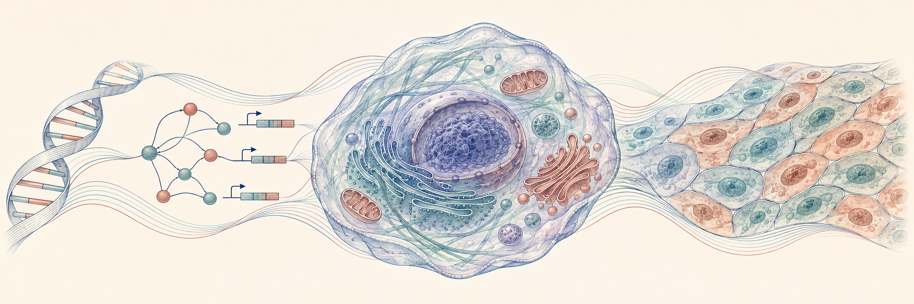
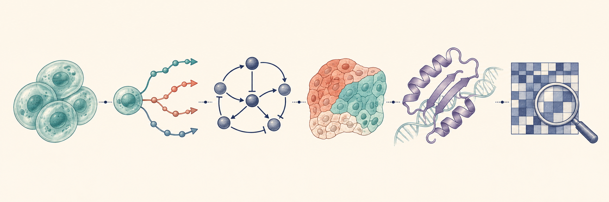

# 计算生物学论文精选

[English](README.md) · **简体中文**

[**打开计算生物学文献图谱**](https://tudu1223.github.io/awesome-computational-biology-papers/?lang=zh) · [English site](https://tudu1223.github.io/awesome-computational-biology-papers/?lang=en)

网站现收录 **1,030 篇**，可按需组合筛选，或搜索题名、作者、方法名和 DOI。下方 85 篇导读也同步收录在网站的「精选导读」中。

一份计算生物学阅读清单，覆盖单细胞与空间组学、扰动响应、调控网络，以及基因组和蛋白质机器学习。每条附一则中文导读和公开来源。

**85 篇精选导读 · 6 个主题**\
更新于 2026-11-24，预印本在条目中标记。

## 主题导航

| 主题 | 篇数 | 收录范围 |
| --- | ---: | --- |
| [单细胞与多组学](#single-cell) | 17 | 基础模型、组学整合与细胞图谱 |
| [扰动建模与虚拟细胞](#perturbation) | 17 | 扰动响应模型、筛选数据集与泛化基准 |
| [基因调控网络与功能推断](#regulation) | 11 | 增强子与靶基因、调控子及网络推断 |
| [空间组学](#spatial) | 13 | 空间测量、映射、解卷积与组织表型 |
| [基因组与蛋白质建模](#genomics-proteins) | 14 | 序列到功能预测、结构与相互作用 |
| [基础方法与工具](#methods) | 13 | 图学习、分析工作流与评估 |

## 从哪里开始

- **入门单细胞分析** · [单细胞分析最佳实践](https://doi.org/10.1038/s41576-023-00586-w) → [Scanpy](https://doi.org/10.1186/s13059-017-1382-0) → [scVI](https://doi.org/10.1038/s41592-018-0229-2)
- **设计扰动预测评测** · [scPerturb](https://doi.org/10.1038/s41592-023-02144-y) → [线性基线比较](https://doi.org/10.1038/s41592-025-02772-6) → [Systema](https://doi.org/10.1038/s41587-025-02777-8)
- **从染色质读出理解基因调控** · [SCENIC+](https://doi.org/10.1038/s41592-023-01938-4) → [scE2G](https://doi.org/10.1038/s41588-026-02695-8) → [BEELINE](https://doi.org/10.1038/s41592-019-0690-6)

## 单细胞与多组学

### 基础模型与细胞注释

- **Universal cell embedding provides a foundation model for cell biology** · Nature · 2026 · [论文](https://doi.org/10.1038/s41586-026-10689-z)\
  **UCE** · 将不同细胞类型和物种的基因表达谱映射到共享表示空间。
- **Biological Reasoning with Reinforcement Learning through Natural Language Enables Generalizable Zero-Shot Cell Type Annotations** · bioRxiv · 2025 · `预印本` · [论文](https://doi.org/10.1101/2025.06.17.659642) · [代码](https://github.com/cristea-lab/BioReasoning_Paper)\
  **BioReasoning** · 评估推理语言模型能否根据标记基因进行零样本细胞类型注释。
- **Large-scale foundation model on single-cell transcriptomics** · Nature Methods · 2024 · [论文](https://doi.org/10.1038/s41592-024-02305-7)\
  **scFoundation** · 使用大规模转录组预训练细胞与基因表示。
- **scGPT: toward building a foundation model for single-cell multi-omics using generative AI** · Nature Methods · 2024 · [论文](https://doi.org/10.1038/s41592-024-02201-0) · [代码](https://github.com/bowang-lab/scGPT)\
  在单细胞表达谱上预训练生成式 Transformer，再适配多个下游任务。
- **Transfer learning enables predictions in network biology** · Nature · 2023 · [论文](https://doi.org/10.1038/s41586-023-06139-9) · [模型](https://huggingface.co/ctheodoris/Geneformer)\
  **Geneformer** · 以表达排序编码和迁移学习研究基因网络行为。
- **Boosting Single-Cell RNA Sequencing Analysis with Simple Neural Attention** · bioRxiv · 2023 · `预印本` · [论文](https://doi.org/10.1101/2023.05.29.542760)\
  **scANNA** · scANNA 将简单的神经注意力用于单细胞 RNA 测序分析，并考察模型关注的基因。

### 整合与表示学习

- **High-fidelity bidirectional translation between single-cell transcriptomes and DNA methylomes with scBOND** · Genome Research · 2026 · [论文](https://doi.org/10.1101/gr.281350.125)\
  scBOND 研究如何在单细胞转录组与 DNA 甲基化组之间双向预测。
- **MultiVI: deep generative model for the integration of multimodal data** · Nature Methods · 2023 · [论文](https://doi.org/10.1038/s41592-023-01909-9)\
  整合配对和非配对数据中的表达与染色质可及性。
- **Multi-omics single-cell data integration and regulatory inference with graph-linked embedding** · Nature Biotechnology · 2022 · [论文](https://doi.org/10.1038/s41587-022-01284-4) · [代码](https://github.com/gao-lab/GLUE)\
  **GLUE** · GLUE 以调控先验图连接不同组学的特征，用于细胞对齐与调控关系推断。
- **Probabilistic harmonization and annotation of single-cell transcriptomics data with deep generative models** · Molecular Systems Biology · 2021 · [论文](https://doi.org/10.15252/msb.20209620)\
  **scANVI** · 将单细胞生成建模扩展到半监督细胞类型注释。
- **Joint probabilistic modeling of single-cell multi-omic data with totalVI** · Nature Methods · 2021 · [论文](https://doi.org/10.1038/s41592-020-01050-x)\
  用共享潜在表示联合建模配对的 RNA 与蛋白质测量。
- **Integrated analysis of multimodal single-cell data** · Cell · 2021 · [论文](https://doi.org/10.1016/j.cell.2021.04.048)\
  **WNN** · 从配对测量中学习模态权重，构建联合细胞邻域图。
- **Deep generative modeling for single-cell transcriptomics** · Nature Methods · 2018 · [论文](https://doi.org/10.1038/s41592-018-0229-2) · [代码](https://github.com/scverse/scvi-tools)\
  **scVI** · 用深度生成模型对单细胞计数进行降维和统计推断。

### 图谱与数据资源

- **An emergent disease-associated motor neuron state precedes cell death in ALS** · Cell · 2026 · [论文](https://doi.org/10.1016/j.cell.2026.05.047)\
  **ALS motor neuron states** · 用纵向单细胞多组学追踪 ALS 模型中的运动神经元状态变化。
- **CZ CELLxGENE Discover: a single-cell data platform for scalable exploration, analysis and modeling of aggregated data** · Nucleic Acids Research · 2025 · [论文](https://doi.org/10.1093/nar/gkae1142)\
  介绍聚合单细胞数据的平台及其程序化访问方式。
- **The Tabula Sapiens: A multiple-organ, single-cell transcriptomic atlas of humans** · Science · 2022 · [论文](https://doi.org/10.1126/science.abl4896)\
  提供覆盖多个器官与供体的人类细胞参考图谱。
- **The Human Cell Atlas** · eLife · 2017 · [论文](https://doi.org/10.7554/eLife.27041)\
  阐述建立系统性人类细胞参考图谱的目标与范围。

## 扰动建模与虚拟细胞

### 扰动响应模型

- **Predicting cellular responses to perturbation across diverse contexts with State** · Cell · 2026 · [论文](https://doi.org/10.1016/j.cell.2026.07.052) · [代码](https://github.com/ArcInstitute/state)\
  以细胞集合为单位预测扰动响应，并考虑细胞异质性。
- **UniPert-G2CP bridges genetic and chemical screens from molecular representation to phenotype modeling** · Cell · 2026 · [论文](https://doi.org/10.1016/j.cell.2026.06.005)\
  在共享表示中建模遗传和化学扰动，研究如何利用遗传筛选数据预测药物响应。
- **A pretrained unified model enables cellular functional profile prediction and multi-objective virtual drug screening** · bioRxiv · 2026 · `预印本` · [论文](https://doi.org/10.64898/2026.08.25.746866) · [代码](https://github.com/Bin-Chen-Lab/insilicoCell)\
  **InsilicoCell** · InsilicoCell 预训练多模态、多任务模型，用于细胞功能谱预测和虚拟药物筛选。
- **SCALE: Scalable Conditional Atlas-Level Endpoint transport for virtual cell perturbation prediction** · bioRxiv · 2026 · `预印本` · [论文](https://doi.org/10.64898/2026.03.17.712536)\
  从未扰动细胞和给定条件预测受扰动后的细胞状态分布。
- **TwinCell: Large Causal Cell Model for Reliable and Interpretable Therapeutic Target Prioritisation** · bioRxiv · 2026 · `预印本` · [论文](https://doi.org/10.64898/2026.01.29.702072)\
  结合单细胞表示与多组学互作网络，对可能驱动疾病状态改变的上游调控因子排序。
- **Predicting transcriptional outcomes of novel multigene perturbations with GEARS** · Nature Biotechnology · 2024 · [论文](https://doi.org/10.1038/s41587-023-01905-6) · [代码](https://github.com/snap-stanford/GEARS)\
  借助基因关系图预测未见多基因扰动的转录效应。
- **Predicting cellular responses to complex perturbations in high-throughput screens** · Molecular Systems Biology · 2023 · [论文](https://doi.org/10.15252/msb.202211517)\
  **CPA** · 分离扰动与协变量的表示，用于建模细胞响应和组合效应。
- **scGen predicts single-cell perturbation responses** · Nature Methods · 2019 · [论文](https://doi.org/10.1038/s41592-019-0494-8)\
  在潜在空间估计未见细胞背景中的单细胞响应。

### 图谱与数据集

- **Tahoe-100M: Mapping drug-induced molecular phenotypes at single-cell resolution** · Cell · 2026 · [论文](https://doi.org/10.1016/j.cell.2026.08.035)\
  提供跨多种癌细胞系的大规模单细胞药物响应图谱。
- **scPerturb: harmonized single-cell perturbation data** · Nature Methods · 2024 · [论文](https://doi.org/10.1038/s41592-023-02144-y) · [项目](https://scperturb.org/)\
  统一整理公开的单细胞扰动数据，并引入 E-distance 用于比较。
- **Mapping information-rich genotype-phenotype landscapes with genome-scale Perturb-seq** · Cell · 2022 · [论文](https://doi.org/10.1016/j.cell.2022.05.013)\
  用全基因组规模的单细胞扰动数据分析基因型与表型的关系。
- **Exploring genetic interaction manifolds constructed from rich single-cell phenotypes** · Science · 2019 · [论文](https://doi.org/10.1126/science.aax4438)\
  **Combinatorial Perturb-seq** · 根据组合扰动后的表达谱推断遗传互作。
- **Perturb-Seq: Dissecting Molecular Circuits with Scalable Single-Cell RNA Profiling of Pooled Genetic Screens** · Cell · 2016 · [论文](https://doi.org/10.1016/j.cell.2016.11.038)\
  介绍将混合扰动筛选与单细胞转录组读出关联的方法。

### 基准与对照

- **Benchmarking algorithms for generalizable single-cell perturbation response prediction** · Nature Methods · 2026 · [论文](https://doi.org/10.1038/s41592-025-02980-0)\
  **Generalization benchmark** · 跨数据集和评估指标比较扰动预测方法的泛化表现。
- **Systema: a framework for evaluating genetic perturbation response prediction beyond systematic variation** · Nature Biotechnology · 2026 · [论文](https://doi.org/10.1038/s41587-025-02777-8)\
  在控制共享系统性变异后评估遗传扰动预测。
- **A systematic comparison of single-cell perturbation response prediction models** · Science Advances · 2026 · [论文](https://doi.org/10.1126/sciadv.aed3414)\
  **Systematic perturbation benchmark** · 从多个指标比较未见扰动、组合扰动和跨细胞类型预测。
- **Deep-learning-based gene perturbation effect prediction does not yet outperform simple linear baselines** · Nature Methods · 2025 · [论文](https://doi.org/10.1038/s41592-025-02772-6)\
  **Linear baseline benchmark** · 在遗传扰动任务中将深度模型与简单线性和均值基线比较。

## 基因调控网络与功能推断

### 调控推断与建模

- **Mapping enhancer–gene regulatory interactions from single-cell data** · Nature Genetics · 2026 · [论文](https://doi.org/10.1038/s41588-026-02695-8)\
  **scE2G** · scE2G 根据单细胞染色质可及性等数据预测细胞类型特异的增强子与靶基因连接。
- **Multimodal physical evidence uncovers interpretable gene regulatory networks for perturbation prediction** · bioRxiv · 2026 · `预印本` · [论文](https://doi.org/10.64898/2026.06.05.729520)\
  **VitaGRN** · VitaGRN 用多模态生物物理证据构建调控网络，并评估其在扰动预测中的表现。
- **Inferring gene regulatory networks with graph convolutional network based on causal feature reconstruction** · Scientific Reports · 2024 · [论文](https://doi.org/10.1038/s41598-024-71864-8)\
  将转移熵和特征重构结合到图卷积网络中，用于推断调控边。
- **Dissecting cell identity via network inference and in silico gene perturbation** · Nature · 2023 · [论文](https://doi.org/10.1038/s41586-022-05688-9) · [代码](https://github.com/morris-lab/CellOracle)\
  **CellOracle** · 基于推断的调控网络，模拟转录因子变化对细胞状态的潜在影响。
- **Dictys: dynamic gene regulatory network dissects developmental continuum with single-cell multiomics** · Nature Methods · 2023 · [论文](https://doi.org/10.1038/s41592-023-01971-3)\
  推断依赖细胞背景的调控网络，并沿状态变化追踪网络动态。
- **Inferring and perturbing cell fate regulomes in human brain organoids** · Nature · 2023 · [论文](https://doi.org/10.1038/s41586-022-05279-8)\
  **Pando** · 利用脑类器官的单细胞多模态测量建模基因调控。
- **SCENIC+: single-cell multiomic inference of enhancers and gene regulatory networks** · Nature Methods · 2023 · [论文](https://doi.org/10.1038/s41592-023-01938-4) · [代码](https://github.com/aertslab/scenicplus)\
  结合染色质可及性和表达数据推断增强子驱动的调控网络。
- **Inference of cell type-specific gene regulatory networks on cell lineages from single cell omic datasets** · Nature Communications · 2023 · [论文](https://doi.org/10.1038/s41467-023-38637-9) · [代码](https://github.com/Roy-lab/scMTNI)\
  **scMTNI** · scMTNI 整合单细胞组学数据，沿细胞谱系推断细胞类型特异的调控网络。
- **SCENIC: single-cell regulatory network inference and clustering** · Nature Methods · 2017 · [论文](https://doi.org/10.1038/nmeth.4463)\
  推断转录因子调控子并量化其在单细胞中的活性。

### 评估与解读

- **Gene function prediction from bulk coexpression is bounded by cell-type-level signal** · bioRxiv · 2026 · `预印本` · [论文](https://doi.org/10.64898/2026.08.31.748380)\
  **Bulk coexpression and function** · 分析细胞类型组成对 bulk 共表达信号及基因功能预测的影响。
- **Benchmarking algorithms for gene regulatory network inference from single-cell transcriptomic data** · Nature Methods · 2020 · [论文](https://doi.org/10.1038/s41592-019-0690-6) · [代码](https://github.com/Murali-group/Beeline)\
  **BEELINE** · BEELINE 在统一评估框架下比较单细胞转录组调控网络推断方法。

## 空间组学

### 空间测量与图谱

- **Spatiotemporal transcriptomic atlas of mouse organogenesis using DNA nanoball-patterned arrays** · Cell · 2022 · [论文](https://doi.org/10.1016/j.cell.2022.04.003)\
  **Stereo-seq** · 以高空间分辨率绘制完整小鼠胚胎的转录图谱。
- **Slide-seq: A scalable technology for measuring genome-wide expression at high spatial resolution** · Science · 2019 · [论文](https://doi.org/10.1126/science.aaw1219)\
  用具有空间索引的微珠阵列绘制组织 RNA 表达图。
- **Visualization and analysis of gene expression in tissue sections by spatial transcriptomics** · Science · 2016 · [论文](https://doi.org/10.1126/science.aaf2403)\
  用位置条形码测量完整组织切片中的基因表达。
- **Spatially resolved, highly multiplexed RNA profiling in single cells** · Science · 2015 · [论文](https://doi.org/10.1126/science.aaa6090)\
  **MERFISH** · 结合多重标记和抗错误编码，对 RNA 分子进行成像。

### 空间映射、建模与分析

- **TiRank prioritizes phenotypic niches in tumor microenvironment for clinical biomarker discovery** · Genome Medicine · 2026 · [论文](https://doi.org/10.1186/s13073-026-01604-2) · [代码](https://github.com/LenisLin/TiRank)\
  用迁移学习联系 bulk、单细胞和空间转录组数据，对肿瘤微环境中的表型生态位排序。
- **Connecting spatial regions to clinical phenotypes by transferring knowledge from bulk gene expression data** · bioRxiv · 2026 · `预印本` · [论文](https://doi.org/10.64898/2025.12.12.693322) · [代码](https://github.com/ncbi/SpacePhenotyper)\
  **SpacePhenotyper** · SpacePhenotyper 将 bulk 表达与临床表型的关联迁移到空间转录组数据。
- **Nicheformer: a foundation model for single-cell and spatial omics** · Nature Methods · 2025 · [论文](https://doi.org/10.1038/s41592-025-02814-z) · [代码](https://github.com/theislab/nicheformer)\
  联合解离单细胞与空间转录组预训练，用于细胞和空间分析任务。
- **SpaRx: elucidate single-cell spatial heterogeneity of drug responses for personalized treatment** · Briefings in Bioinformatics · 2023 · [论文](https://doi.org/10.1093/bib/bbad338)\
  将预测的药物响应映射到组织空间，分析细胞间和区域间的异质性。
- **Cell2location maps fine-grained cell types in spatial transcriptomics** · Nature Biotechnology · 2022 · [论文](https://doi.org/10.1038/s41587-021-01139-4)\
  用贝叶斯模型估计组织各位置的细胞类型丰度。
- **Robust decomposition of cell type mixtures in spatial transcriptomics** · Nature Biotechnology · 2022 · [论文](https://doi.org/10.1038/s41587-021-00830-w)\
  **RCTD** · 借助参考细胞类型表达谱分解空间位置中的混合表达。
- **Squidpy: a scalable framework for spatial omics analysis** · Nature Methods · 2022 · [论文](https://doi.org/10.1038/s41592-021-01358-2) · [代码](https://github.com/scverse/squidpy)\
  为空间组学提供空间图、图像处理和空间统计工具。
- **Deep learning and alignment of spatially resolved single-cell transcriptomes with Tangram** · Nature Methods · 2021 · [论文](https://doi.org/10.1038/s41592-021-01264-7)\
  将单细胞表达谱映射到空间基因表达测量。
- **Reconstruction of cell spatial organization from single-cell RNA sequencing data based on ligand-receptor mediated self-assembly** · Cell Research · 2020 · [论文](https://doi.org/10.1038/s41422-020-0353-2)\
  **CSOmap** · CSOmap 使用配体与受体表达信息重建细胞的相对空间排布。

## 基因组与蛋白质建模

### 基因组模型与参考基因组

- **Advancing regulatory variant effect prediction with AlphaGenome** · Nature · 2026 · [论文](https://doi.org/10.1038/s41586-025-10014-0) · [代码](https://github.com/google-deepmind/alphagenome)\
  从 DNA 序列预测多种调控读出，并评估遗传变异对这些读出的影响。
- **A complete diploid human genome benchmark for personalized genomics** · Cell · 2026 · [论文](https://doi.org/10.1016/j.cell.2026.06.016)\
  **HG002 diploid benchmark** · 提供 HG002 的双单倍型组装基准，用于评估人类基因组组装和变异准确性。
- **TrinityDNA: A Bio-Inspired Foundational Model for Efficient Long-Sequence DNA Modeling** · AAAI · 2026 · [论文](https://doi.org/10.1609/aaai.v40i33.39980)\
  面向长 DNA 序列表示与注释的基因组基础模型。
- **Predicting RNA-seq coverage from DNA sequence as a unifying model of gene regulation** · Nature Genetics · 2025 · [论文](https://doi.org/10.1038/s41588-024-02053-6)\
  **Borzoi** · 从 DNA 序列预测组织特异性 RNA 测序覆盖度。
- **Nucleotide Transformer: building and evaluating robust foundation models for human genomics** · Nature Methods · 2025 · [论文](https://doi.org/10.1038/s41592-024-02523-z)\
  在多种基因组预测任务中评估预训练 DNA 表示。
- **DNABERT: pre-trained Bidirectional Encoder Representations from Transformers model for DNA-language in genome** · Bioinformatics · 2021 · [论文](https://doi.org/10.1093/bioinformatics/btab083)\
  将 BERT 式预训练用于基因组序列和调控预测任务。
- **Effective gene expression prediction from sequence by integrating long-range interactions** · Nature Methods · 2021 · [论文](https://doi.org/10.1038/s41592-021-01252-x) · [代码](https://github.com/google-deepmind/deepmind-research/tree/master/enformer)\
  **Enformer** · 从长片段 DNA 序列预测调控信号，用于研究远端调控。

### 蛋白质结构与相互作用

- **DSS-PPI: a self-supervised graph learning framework for protein-protein interaction prediction via multimodal sequence semantics** · BMC Genomics · 2026 · [论文](https://doi.org/10.1186/s12864-026-12762-3)\
  将蛋白质序列表征与自监督图学习结合，用于预测蛋白质互作。
- **Expanding the scope of protein language modeling to protein-protein interactions with MSA Pairformer** · Cell · 2026 · [论文](https://doi.org/10.1016/j.cell.2026.06.029)\
  用多序列比对学习蛋白质表示，并评估模型对互作界面和界面变异效应的预测。
- **Molecular Prior Networks** · arXiv · 2026 · `预印本` · [论文](https://arxiv.org/abs/2611.05103)\
  研究如何在标注数据有限时预测小分子与蛋白质靶标的结合亲和力。
- **Accurate structure prediction of biomolecular interactions with AlphaFold 3** · Nature · 2024 · [论文](https://doi.org/10.1038/s41586-024-07487-w)\
  预测由蛋白质、核酸和小分子等组成的复合物结构。
- **Evolutionary-scale prediction of atomic-level protein structure with a language model** · Science · 2023 · [论文](https://doi.org/10.1126/science.ade2574)\
  **ESMFold** · 用蛋白质语言模型进行宏基因组规模的结构预测。
- **Highly accurate protein structure prediction with AlphaFold** · Nature · 2021 · [论文](https://doi.org/10.1038/s41586-021-03819-2) · [代码](https://github.com/google-deepmind/alphafold)\
  从氨基酸序列预测蛋白质三维结构，并在 CASP14 中评估预测准确度。
- **Biological structure and function emerge from scaling unsupervised learning to 250 million protein sequences** · Proceedings of the National Academy of Sciences · 2021 · [论文](https://doi.org/10.1073/pnas.2016239118)\
  **ESM-1b** · 检验蛋白质序列无监督训练能学习到哪些结构与功能信号。

## 基础方法与工具

### 图学习

- **Graph Attention Networks** · ICLR · 2018 · [论文](https://arxiv.org/abs/1710.10903)\
  **GAT** · 用注意力对邻居信息加权，是理解图注意力层的基础论文。
- **Semi-Supervised Classification with Graph Convolutional Networks** · ICLR · 2017 · [论文](https://arxiv.org/abs/1609.02907)\
  **GCN** · 介绍用于图上半监督节点分类的图卷积网络。
- **Inductive Representation Learning on Large Graphs** · NeurIPS · 2017 · [论文](https://papers.nips.cc/paper_files/paper/2017/hash/5dd9db5e033da9c6fb5ba83c7a7ebea9-Abstract.html)\
  **GraphSAGE** · GraphSAGE 通过采样、聚合邻居特征，为训练时未见的节点生成表示。
- **Neural Message Passing for Quantum Chemistry** · ICML · 2017 · [论文](https://proceedings.mlr.press/v70/gilmer17a.html)\
  **MPNN** · 将多种分子图模型归纳为消息传递框架，并用于分子性质预测。

### 工作流、工具与基准

- **Zero-shot evaluation reveals limitations of single-cell foundation models** · Genome Biology · 2025 · [论文](https://doi.org/10.1186/s13059-025-03574-x)\
  **Zero-shot foundation model benchmark** · 以常用基线为对照，评估 Geneformer 和 scGPT 的零样本表示。
- **Dictionary learning for integrative, multimodal and scalable single-cell analysis** · Nature Biotechnology · 2024 · [论文](https://doi.org/10.1038/s41587-023-01767-y)\
  **Seurat v5** · 用字典学习开展多模态整合，并将分析扩展到大规模细胞集合。
- **Best practices for single-cell analysis across modalities** · Nature Reviews Genetics · 2023 · [论文](https://doi.org/10.1038/s41576-023-00586-w)\
  **Single-cell best practices** · 综述不同模态的单细胞分析工作流及实际选择。
- **Benchmarking atlas-level data integration in single-cell genomics** · Nature Methods · 2022 · [论文](https://doi.org/10.1038/s41592-021-01336-8) · [代码](https://github.com/theislab/scib)\
  **scIB** · 用批次去除和生物信号保留指标评估单细胞整合。
- **Fast, sensitive and accurate integration of single-cell data with Harmony** · Nature Methods · 2019 · [论文](https://doi.org/10.1038/s41592-019-0619-0)\
  在低维单细胞表示中校正不需要的批次差异。
- **Comprehensive Integration of Single-Cell Data** · Cell · 2019 · [论文](https://doi.org/10.1016/j.cell.2019.05.031)\
  **Seurat anchors** · 介绍基于锚点的数据整合与标签迁移方法。
- **Applications of Deep Learning and Reinforcement Learning to Biological Data** · IEEE Transactions on Neural Networks and Learning Systems · 2018 · [论文](https://doi.org/10.1109/TNNLS.2018.2790388)\
  **Deep learning and RL review** · 回顾深度学习和强化学习在生物数据分析中的早期应用。
- **SCANPY: large-scale single-cell gene expression data analysis** · Genome Biology · 2018 · [论文](https://doi.org/10.1186/s13059-017-1382-0) · [代码](https://github.com/scverse/scanpy)\
  介绍可扩展的单细胞表达分析 Python 工具包。
- **clusterProfiler: an R Package for Comparing Biological Themes Among Gene Clusters** · OMICS: A Journal of Integrative Biology · 2012 · [论文](https://doi.org/10.1089/omi.2011.0118)\
  提供基因集功能富集和多组基因列表比较的 R 工具。

**实践教程** · Scanpy 官方旧版工作流，涵盖质控、归一化、降维、聚类和标记基因分析。[3k PBMC 预处理与聚类](https://scanpy.readthedocs.io/en/stable/tutorials/basics/clustering-2017.html)

## 贡献与说明

欢迎通过 Issue 或 Pull Request 推荐论文、补充资源或修正链接。请附原始标题、来源链接、拟归入的主题和一句导读。有正式发表版本时请优先提供正式链接。

封面与主题图是为本目录生成的概念插图。目录组织参考了 [OmicsML 的单细胞基础模型论文清单](https://github.com/OmicsML/awesome-foundation-model-single-cell-papers)。

网站由 GitHub Pages 从 `docs/` 发布。[目录数据](docs/data/catalog.json)按条记录，[检索与筛选记录](docs/data/provenance.json)保留了来源信息。可运行 `python -m http.server --directory docs` 在本地预览。
